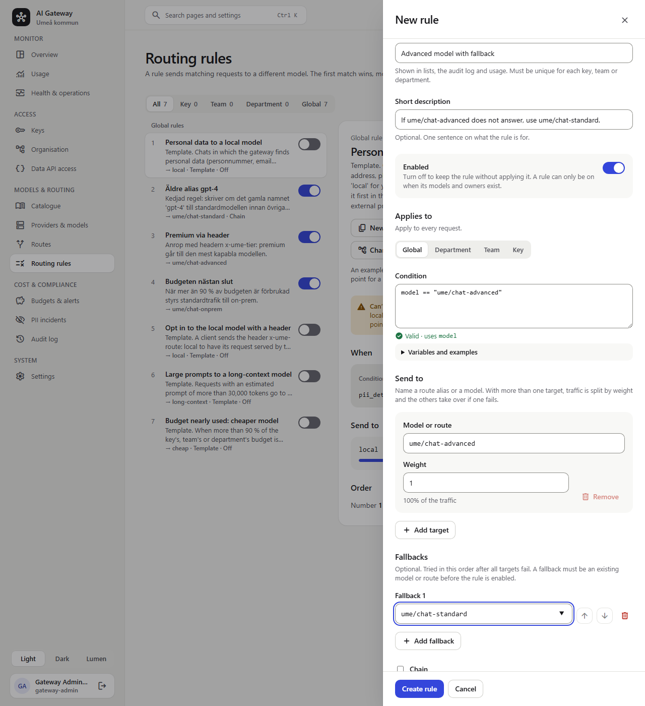
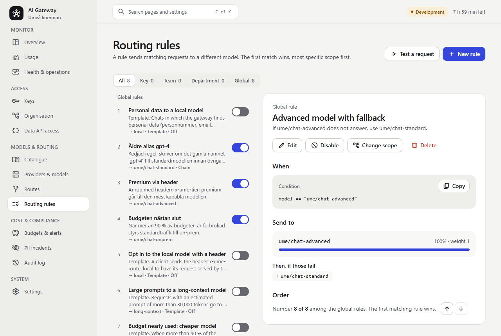
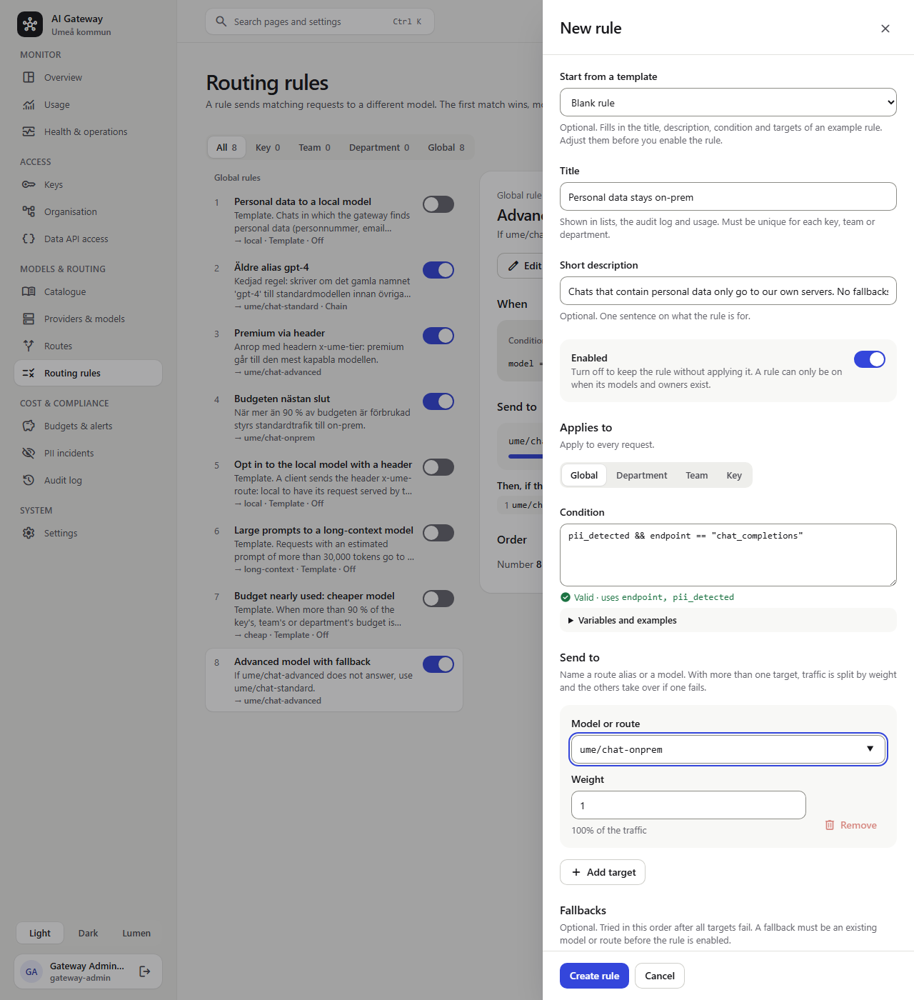
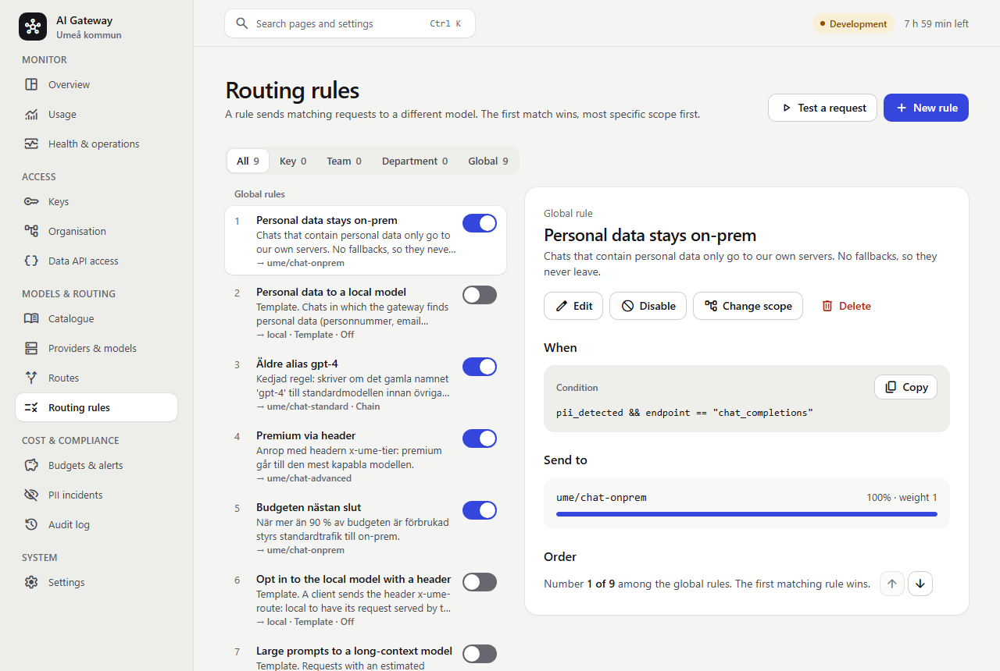
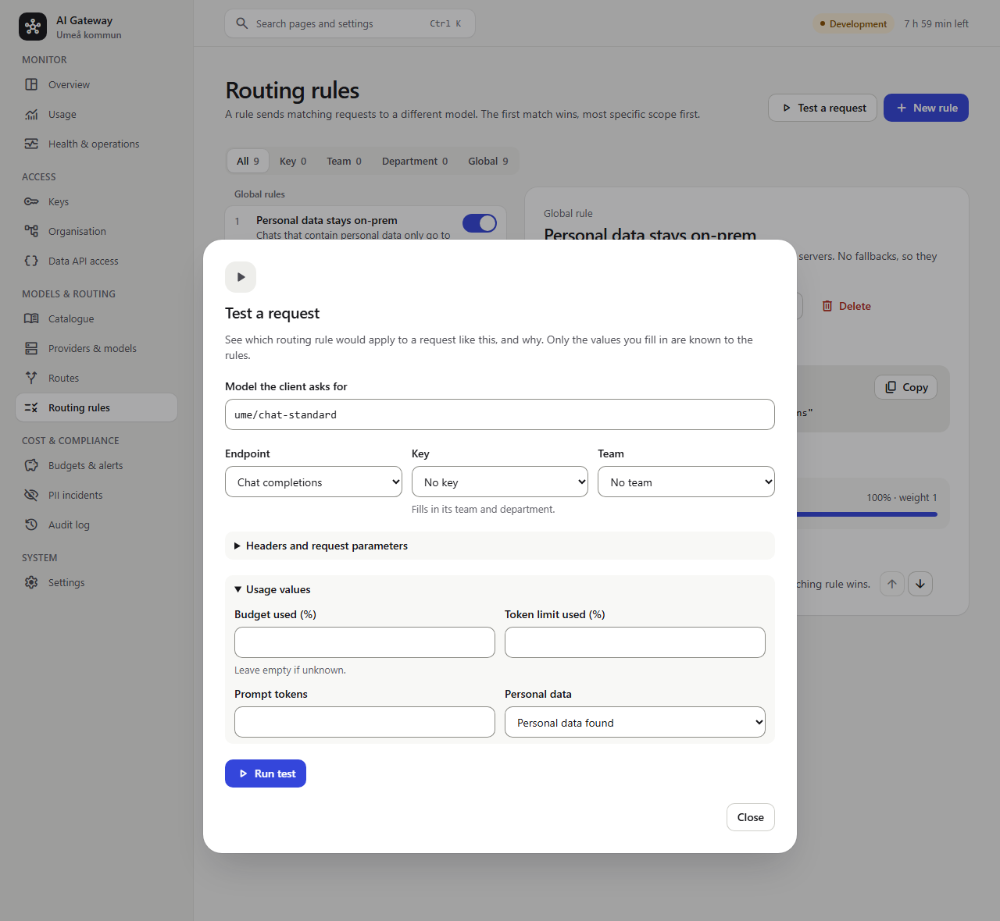
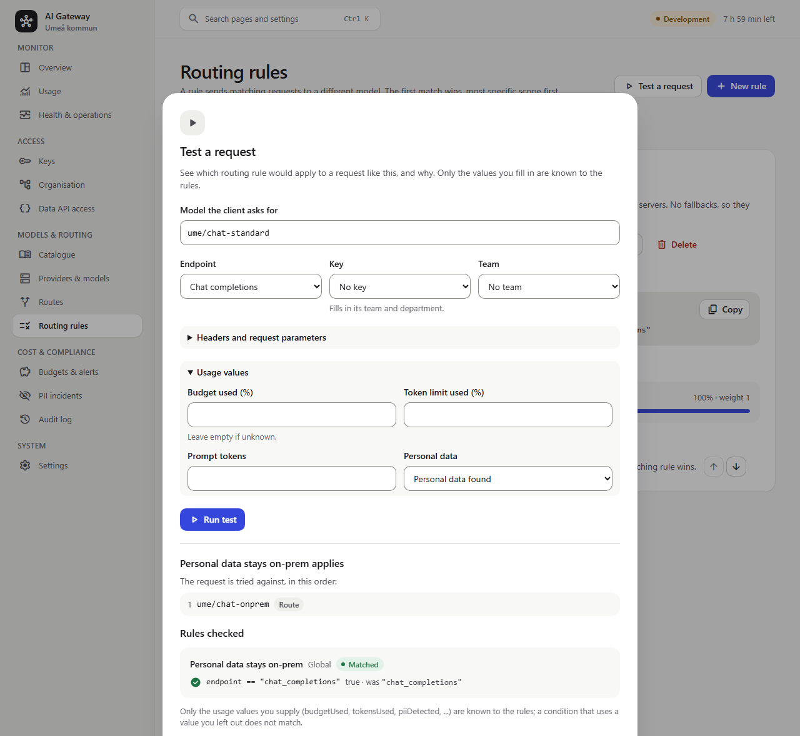
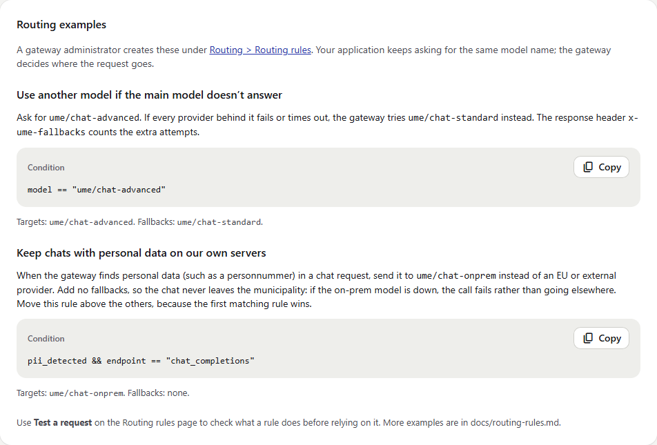

# Umeå kommun LLM gateway POC

.NET 10 data plane and OIDC/BFF control plane, Vue 3/Pinia admin UI, PostgreSQL,
authenticated Redis and Aspire 13.6. This is a demonstrator, **not a production approval,
legal compliance attestation or WCAG certification**.

The gateway provides virtual keys, department/team/key budgets in SEK, provider fallback,
residency restrictions, optional PII policy and a per-key policy for attached files. It stores usage metadata, never prompt or
response content. Providers/models are configuration, not hardcoded model-family lists.
Routing rules (conditions on headers, team, budget use and PII that rewrite where a request goes,
with weights, fallbacks and chaining) are applied to live requests and described in
[Routing rules](docs/routing-rules.md). The `x-ume-rule` response header shows which rule applied. Administrators manage rules through the admin API
(create, validate, dry-run, reorder, reassign); deleting a team or department that has rules asks whether to delete
the rules or deactivate them until a new team or department is assigned.

## Local development

Windows: .NET SDK 10.0.401, Aspire 13.6, Docker 28+, Node 24.15+ recommended.
Use PowerShell 5.1 and run commands separately (or chain with `;` and exit-code checks).

```powershell
Set-Location src\admin-ui
npm ci
Set-Location ..\..
.\scripts\Start-Dev.ps1          # with demo data (default)
.\scripts\Start-Dev.ps1 -Empty   # empty database, only the Keycloak login users
```

The script wraps `aspire start` + `aspire wait admin-ui`; you can still run those directly
(demo data is then on unless `Seed__Enabled=false` is set in the environment).

### Demo data or an empty environment

Seeding (`Seed:Enabled`) runs in the migration service and **only when the database has no
departments**. Demo data is fictional förvaltningar, teams, providers, models, prices, routes and
a dev key and three example routing rules (see [Routing rules](docs/routing-rules.md)). In the empty variant you sign in with a Keycloak test user (`gateway-admin`) and create
everything yourself. To switch an existing local environment, stop the stack, delete the
AppHost's Postgres Docker volume (`docker volume ls`, then `docker volume rm <name>`; or the
volume named in `DevelopmentVolumes:Postgres`) and start again.

### Fake LLM toggle

The fake provider (`fake-llm`) starts with the AppHost by default. Set `"FakeLlm:Enabled": false`
in the AppHost user secrets (or `FakeLlm__Enabled=false` in the environment) to skip it. The admin UI
badge shows **Development** or **Production** from the admin API's environment.

### Running from Visual Studio

1. Install Visual Studio 2022 17.14+ (or newer) with the .NET 10 SDK, Docker Desktop (running), Node 24+, and run `dotnet dev-certs https --trust` once.
2. Open `UmeLlmGateway.slnx`, set `Ume.LlmGateway.AppHost` as startup project, profile **https**.
3. Right-click the AppHost project > **Manage User Secrets** and paste the dev secrets JSON
   (`Parameters:*` for pepper, dev-key, OIDC secret, dev user password, Redis and **Postgres**
   passwords, plus `DevelopmentVolumes:Postgres`). Keep them stable: the Postgres volume stores the
   password it was created with, and the key pepper hashes all virtual keys, so changing either
   later breaks the existing data. With these set, data survives restarts and `git pull`
   (migrations run automatically). Aspire generates the passwords itself if you skip this step.
4. `"Seed:Enabled": false` = empty environment; `true` or omitted = demo data. It only takes effect on
   an empty database (delete the Postgres Docker volume to switch).
5. Press F5. The Aspire dashboard opens; click the `admin-ui` endpoint. Keycloak test users are
   created from `dev/keycloak`; the shared dev password is the `dev-user-password` secret.

### Environments (dev / test / production)

There is no separate "test" configuration; the mode decides the environment:

| Environment | How | Identity | Data |
|---|---|---|---|
| Development | `aspire start` / `Start-Dev.ps1` (run mode, `Development`) | Keycloak test realm (optional: set `Oidc:Authority` in AppHost user secrets to use an existing provider), FakeLlm, optional Ollama | Demo or empty, see above |
| Test (production-shaped) | `.\deploy\Test-Deployment.ps1` (isolated, throw-away) | Test-only secrets | Empty, never seeded |
| Production | `deploy/compose.prod.yaml` after `deploy/init-deployment.sh` (`ASPNETCORE_ENVIRONMENT=Production`) | External HTTPS OIDC | Never seeded (`Seed__Enabled=false`); no Keycloak or FakeLlm |

Production inputs (OIDC authority/client, certificates, secrets, provider endpoints) are
generated or prompted for by `deploy/init-deployment.sh` (see *Quick production setup* below) and
described in [the runbook](docs/runbook.md). Other settings can be overridden
with `Section__Key` environment variables (for example `Ollama__Enabled=true`, development only).

### Admin UI

`src/admin-ui` is Vue 3 + Pinia + Vue Router with Reka UI primitives and Tailwind CSS v4, built from the design prototype in
`Design prototype/` (tokens in `src/admin-ui/src/styles/tokens.css`, Tailwind config in
`tailwind.config.cjs`). The UI is English only, with light, dark and Lumen themes
(`data-theme`, remembered in `localStorage`). Reusable building blocks live in
`src/components/ui` (buttons, tables, drawers, dialogs, form fields, meters), the page shell in
`src/components/layout`, and pages in `src/views`. Icons are a subset of Material Symbols; after
adding an icon name run `python src/admin-ui/scripts/subset-icons.py` (it needs the Python package `fonttools[woff]`).

#### Provider status and stability

The **Providers** card on Overview and the provider table on **Operations** show each provider's status. The admin API
computes it each time the page loads (Operations has *Refresh*; nothing is cached or stored):

- **Circuit open** while the gateway's circuit breaker is open (by default 5 transient failures within 60 s open it for 30 s; an
  admin can open or close it for 15 minutes), **Disabled** for a disabled provider.
- Otherwise from the **last hour**: with no requests *No recent traffic*; with fewer than 10 *Healthy* (too few to judge);
  otherwise **Degraded** when 5 % or more of the requests failed at the provider and **Down** from 50 %. The reason
  ("4 of 40 requests failed at the provider in the last hour (10 %).") is shown next to the status.
- Only **provider errors** count: 5xx answers, timeouts and streams that broke off. Client errors the provider rejected
  (4xx), cancelled requests, the gateway's own internal errors and requests the gateway refused (budget, rate limit, PII)
  do not. A burst of failures therefore stops affecting the status an hour later.

The 24-hour columns (requests, provider errors, all failed requests, p50, p95) come from the same usage records. Every
request's latency is stored (`UsageRecords.LatencyMs`): the whole request as the client saw it, from acceptance to the
last byte, so it includes failed fallback attempts and the full length of a streamed answer (a p95 of several seconds
usually means long streamed answers, not a slow first token). The gateway writes one record per request, on the provider
that answered (or failed last); a provider that failed and was replaced by a fallback is not charged with that failure
in the statistics (only its circuit breaker sees it); a request on which every provider failed (502/504
`all_providers_failed`) is recorded on the last provider tried, so a provider that is down shows up as failing.

**Operations > Provider stability** shows p95 latency and the provider error rate per provider over the last 24 hours or
7 days (per hour) or 30 days (per day, Swedish time), plus a ranking with the most stable provider first (availability,
then p95). Each chart has a text summary and a table view. The data comes from `GET /api/ops/providers/stats`
([docs/admin-api.md](docs/admin-api.md)).

#### Routing rules page

**Routing > Routing rules** (gateway-admin) manages [routing rules](docs/routing-rules.md): rules are listed by
scope in the order the gateway checks them, each with its title, short description and an on/off switch, and the selected
rule's owners, condition, weighted targets and fallbacks on the right. A rule can be shared by several keys, teams or
departments, so the same rule does not have to be set up for each key. Four disabled **template** rules (personal data to a
local model, header opt-in, large prompts, budget nearly used) show how rules are written; switch one on once its target route
exists, or start a new rule from it. From there you can create and edit rules (the condition is validated as you type), switch a rule on or off, move it
earlier or later, change its owners and delete it. **Test a request** runs a sample request against the stored rules and
shows which rule applies and why. When you delete a team or department in **Organisation** that has routing rules, the UI asks
whether to delete the rules or deactivate them until a new team or department is assigned; deactivated rules show up under
**Needs owner**. Usage shows which rule routed a request.

#### Discovering provider models

Instead of typing models in by hand, open a provider (**Providers & models**) and choose
**Discover models**. The Admin API calls the provider with its stored credential, so a
successful list also proves the connection and credential work. Pick the models to add and
the gateway creates them with what the provider reports:

| Provider | Listing endpoint | Reported details |
|---|---|---|
| OpenAI, OpenAI-compatible | `GET {baseUrl}/models` | context size and USD prices where present (OpenRouter-style) |
| Azure AI Foundry | `GET https://<resource>.services.ai.azure.com/api/projects/<project>/deployments?api-version=v1` (only the deployed models, by deployment name) | model, version, capabilities and a suggested USD price from Azure's list prices |
| Anthropic | `GET {baseUrl}/models`; Claude on Foundry (project endpoint as base URL) lists its Claude deployments from the project API | context size and capabilities |
| Ollama, Ollama Cloud | `GET /api/tags` then `POST /api/show` (a trailing `/v1` is stripped from the base URL) | context size and capabilities (tools, vision, thinking, embedding, ...) |
| Azure OpenAI | not supported (deployments are not listable via the data plane) | add models manually |

For Azure AI Foundry, paste the **project endpoint** from the Foundry portal (`https://<resource>.services.ai.azure.com/api/projects/<project>`)
as the base URL. It is saved as entered, because discovery needs the project: `/openai/v1/models` would list every model the
resource *could* deploy, so discovery asks the project API for the deployments instead, and a model is added under its deployment
name, the name requests use. Requests go to the resource's `…/openai/v1`, which the gateway derives from the project endpoint.
A base URL without a project (`…/openai/v1` or the bare resource address) also works for requests, but discovery then has to use
Foundry's default project (`_project`), which not every resource has (404: enter the project endpoint). A Foundry provider set up
as *OpenAI-compatible* lists the whole catalogue.

**The same model from several providers.** A model's name is unique per provider (case-insensitively), so Foundry and
Ollama Cloud can both offer `DeepSeek-V4.1-Flash`. Clients call a model by its *public name*: the plain name while only one
provider has it, `<provider>/<model>` once several do (`<provider>/<model>` always works; the model list shows the public
name). A plain name several providers share is refused with `400 model_ambiguous`, listing the choices: the gateway never
picks a provider, and nothing falls back to another provider by itself, because providers can have different contracts and
failing can be better than an unexpected provider. To spread or fall back between providers, create a route under
*Routes* (it may carry the plain name; the route is then used) and order its targets. A key that allows the plain name
may use each provider's model of that name; restrict providers with the key's provider list.

**One Foundry resource, two providers.** The gateway speaks a provider's protocol by its *type*, not by the model, and
translates between them: clients can call `/v1/chat/completions` for any model, including Claude. On Foundry, OpenAI,
DeepSeek, Grok, Llama, Mistral and other models are served by the OpenAI v1 API, but Claude only by the Anthropic API. So
add the resource twice with the same key:

| Provider type | Base URL | Authentication | Discovery lists |
|---|---|---|---|
| Azure AI Foundry | the project endpoint, `https://<resource>.services.ai.azure.com/api/projects/<project>` (requests go to `…/openai/v1`) | API key header (`api-key`) | every deployment except Claude |
| Anthropic | the same project endpoint (requests go to `…/anthropic/v1`) | API key header (`api-key`) | the Claude deployments |

Tick *Responses* on the Foundry provider for GPT-5/GPT-6 and other models used through `/v1/responses`. Reasoning models
(o-series, GPT-5 and later) are added with the reasoning parameter profile, which sends `max_completion_tokens` and drops
the sampling parameters they reject.

**Suggested Foundry prices.** Azure's deployment list has no prices, so discovery looks the model up in Azure's public
retail price list (`https://prices.azure.com`, no key; the admin API needs outbound HTTPS to it) for the region in
`Admin:AzurePriceRegion` (default `swedencentral`, i.e. `Admin__AzurePriceRegion`). The list names meters in free text
(`gpt 4.1 cached Inp glbl Tokens`, `GPT 5 Mini Inpt DZone 1M Tokens`), so a price is suggested only when the meters for
the deployment's model, version and type (Global, Data Zone or Regional standard) agree on one input, output and, where
listed, cached-input and audio-token price. Provisioned and batch deployments, Claude (billed through Azure Marketplace)
and models the list names differently get no suggestion. A suggested price shows *Azure list price* and the meters it
came from; it is a list price, so check it against your agreement before you add the model. The list is cached for 12 hours.

Capabilities are stored on each model (`features`), shown in the Models table, and can be
edited in the model drawer. Most providers, including Ollama Cloud, do not publish prices, so
add them under the model's price history. Prices are in USD, so also enter the USD exchange rate under **Settings**:
until one is in effect the gateway uses `Gateway:FallbackSekPerUsd` (10 SEK), logs a warning and reports its readiness
check `exchange-rate` as Degraded (visible under operations health). Audio, image-generation-only and moderation models
are left out of the list. Models added before this feature have no capabilities until you set
them or re-add them through discovery. Database migration `ModelFeatures` adds the column and
runs with the normal migration service.

The UI is `https://localhost:5173`. Local Keycloak test users/roles are provisioned by
the realm import; get development passwords through Aspire's secret store without
printing them, enabling transcripts or saving browser auth state. Ollama is opt-in:
set `Ollama__Enabled=true` before starting. FakeLlm is the default test provider.
Stop **this exact AppHost** before backend/AppHost edits or builds:

```powershell
aspire stop --apphost src\Ume.LlmGateway.AppHost\Ume.LlmGateway.AppHost.csproj --non-interactive
dotnet build UmeLlmGateway.slnx -v q -nologo
dotnet test --solution UmeLlmGateway.slnx
Set-Location src\admin-ui
npm run lint
npm run typecheck
npm test
```

`npm run lint` fails on warnings, exactly like CI (`npm run lint:fix` fixes most). To catch it before
pushing, enable the pre-commit hook once per clone: `git config core.hooksPath .githooks`.
Debug builds of the admin API (Visual Studio, F5) also run the lint and show problems as a build warning
(skipped when `node_modules` is missing or `CI=true`).

Browser tests (`tests\e2e`, Playwright) need a running stack. Use the separate test database so your
development data is never touched:

```powershell
.\scripts\Start-E2E.ps1          # own Docker volume (ume-e2e-postgres), reset on every start, demo data, fake LLM on
Set-Location tests\e2e
npm ci
npx playwright install chromium
npx tsc --noEmit
npx playwright test
Set-Location ..\..
.\scripts\Start-E2E.ps1 -Stop    # stops the stack and removes the test database
```

The test stack uses the same ports as the dev stack, so stop the dev stack first. The tests cover sign-in, keys
(show-once secret, rotation, revocation), organisation, usage, audit, budgets, the demo scenario, routing
rules (create, validate, test, reorder, disable, delete, team and department deletion and reassignment, key rotation, `budget_used`/`tokens_used`, with real gateway
requests) and accessibility (axe at WCAG 2.2 AA in the three themes, drawers and dialogs, reflow, keyboard,
forced colours, target size). They do not save screenshots, videos, traces or storage state.
No manual screen reader testing is planned; open follow-ups are listed in [HANDOVER.md](HANDOVER.md).

### Benchmarks

The gateway's data plane is benchmarked in `benchmarks/Ume.LlmGateway.Benchmarks` (needs Docker; always Release):

```powershell
dotnet run -c Release --project benchmarks\Ume.LlmGateway.Benchmarks -- --filter *   # BenchmarkDotNet, ~20 min
dotnet run -c Release --project benchmarks\Ume.LlmGateway.Benchmarks -- audit        # DB/Redis calls per request + load test
```

`benchmarks/compare` compares the gateway with eneo against the same fake LLM (see its README).
Run them before and after changes to the request pipeline. What they measure and the current results are in
[Performance](docs/performance.md).

## Routing examples

Both examples are global rules created under **Routing > Routing rules** (gateway-admin) with the demo data. Your applications keep
asking for the same model name; the rules decide where the request goes. The screenshots were taken from the real UI and are
regenerated by `tests/e2e/docs/screenshots.spec.ts` (see below).

### Example 1: use another model if the main model doesn't answer

*Ask for `ume/chat-advanced`. If every provider behind it fails or times out, try `ume/chat-standard` instead.*

| Field | Value |
|---|---|
| Name | Advanced model with fallback |
| Applies to | Global |
| Condition | `model == "ume/chat-advanced"` |
| Send to | `ume/chat-advanced` (weight 1) |
| Fallbacks | 1. `ume/chat-standard` |



After **Create rule** the rule shows up in the list, in the order the gateway checks it:



How it behaves: the target is tried first (with its own provider order from the route). The fallbacks are tried only when the call fails
in a way that can be retried (a timeout, 408, 409, 429, a 5xx or a provider configuration error), and never after the response has started
streaming. Other client errors (such as 400) are returned as they are. The response header `x-ume-fallbacks` counts the extra attempts and
`x-ume-rule` names the rule. Providers whose circuit breaker is open are moved last, so the fallback is tried before a known-broken primary.
Only transient failures (timeouts, connection errors, 408, 409, 429, 5xx) count toward the circuit breaker; a provider configuration
error (such as an upstream 401, 403 or 404) falls back to the next provider without opening the circuit.

### Example 2 (advanced): chats with personal data go to an on-prem model

*When the gateway finds personal data in a chat (a personnummer, an email address, a phone number, an IBAN), send the request to
`ume/chat-onprem` instead of an EU or external provider.*

| Field | Value |
|---|---|
| Name | Personal data stays on-prem |
| Applies to | Global |
| Condition | `pii_detected && endpoint == "chat_completions"` |
| Send to | `ume/chat-onprem` |
| Fallbacks | none, on purpose |



Three things make this safe:

1. **Order matters: the first matching rule wins.** New rules are added last, so use **Check earlier** (the arrow buttons next to *Order*) until the
   rule is number 1. Otherwise a request with personal data that also matches *Premium via header* would go to `ume/chat-advanced`.
2. **No fallbacks.** If the on-prem model is down the call fails with `503 no_eligible_provider` or `502 all_providers_failed` instead of
   quietly sending the chat to an EU or external provider. Add a fallback only if it is also on-prem.
3. **Rules never widen access.** A key's allowed providers and residencies are applied after the rules, so the rule cannot send a chat anywhere the
   key may not go.



Check the rule before relying on it with **Test a request**: ask for `ume/chat-standard`, open *Usage values* and set *Personal data* to
*Personal data found*:



The result says which rule applies, which models the request is tried against and why each condition was true or false:



On the real gateway (checked with the demo data and a synthetic personnummer): a chat containing `19121212-1212` was served by
`fake-onprem` (`x-ume-residency: OnPrem`, `x-ume-rule` set), while a chat without personal data went to the EU provider as before.

Notes:

- `pii_detected` is evaluated for every request that a rule asks about it, **whatever the key's PII policy** (Off, Allow, Redact), so the rule
  works even for keys that have no PII policy. If the key's policy is **Block**, the request is rejected before the rules run.
- If you only need "personal data stays on-prem" for specific keys, the key's PII policy **Reroute to on-prem** does the same without a rule.
  Use a rule when you want it per team or department, per model, with a chosen on-prem model, or combined with other conditions
  (for example `pii_detected && department_name == "Individ- och familjeomsorgen"`).
- Detection covers Swedish personnummer and samordningsnummer, email addresses, Swedish phone numbers and IBANs (not bankgiro numbers);
  see [Personal data (PII)](#personal-data-pii) for the formats.
  It is a safety net, not a guarantee that no personal data reaches a provider.

The same two examples are on the **Getting started** page of the admin UI:



To regenerate the screenshots after a UI change, start the test stack (`.\scripts\Start-E2E.ps1`) and run
`npx playwright test -c playwright.docs.config.ts` in `tests\e2e`. The script builds the two rules through the UI, so it
changes the (disposable) test database only.

## Restricting a key to client addresses

A key can be limited to the addresses it may be used from, so a leaked key does not work elsewhere. In the admin UI,
edit the key (*Keys*) and enter **Allowed client addresses**: one IP address (`192.0.2.10`, `2001:db8::10`) or CIDR
network (`203.0.113.0/24`) per line, at most 100. Empty means any address. A request from anywhere else is refused with
`403 address_not_allowed` and recorded with its source address like other refused keys. The list is copied to the new key
on rotation.

**Behind a reverse proxy** (the usual production setup), every request reaches the gateway from the proxy. A gateway admin
must list the proxy under **Settings > Trusted proxies**; the gateway then takes the client address from
`X-Forwarded-For`, but only on connections from those addresses. Until then, keys with an address restriction are refused.
Caveats:

- Trust only proxies you operate, never a network that also holds clients: a trusted address can claim to be anyone.
  `0.0.0.0/0` is refused.
- The proxy must append the client address (`proxy_set_header X-Forwarded-For $proxy_add_x_forwarded_for;`; Nginx Proxy
  Manager does it by default). With several proxies in a row, list them all.
- The Settings page shows the address your own request to the admin API came from, which is usually the proxy.
- `ASPNETCORE_FORWARDEDHEADERS_ENABLED` / `UME_FORWARDED_HEADERS` no longer affect the gateway: they would believe the
  header from anyone.
- An address restriction narrows where a key works; it does not replace the key or the firewall.

Both checks run in memory (no database or Redis call): well under a microsecond per request, and nothing at all when
unused (see [performance](docs/performance.md)). Details and troubleshooting: *Client addresses and trusted proxies* in the
[runbook](docs/runbook.md).

## Data retention

Request data is removed automatically so the database does not keep growing. Under **Settings > Data retention** a
gateway admin sets two periods (90–3 650 days, both 365 by default):

- **Usage data:** usage records, refused-key records and old budget alerts. Whole months go, and each month's totals
  per key, model and provider are saved first, so costs, budgets (yearly ones too), the usage summary, the CSV export and the
  Data API monthly figures stay complete. The request list, PII incidents and Data API feeds no longer show removed months.
- **Audit log:** a separate period, or kept for ever.

The admin API runs the removal every night at 03:00 (and on *Run now*) through a database function, so it never needs
delete rights on those tables itself. Set both periods from your records-retention decision (gallringsbeslut) before going
live: removed rows cannot be restored except from a backup. Details: *Data retention* in the [runbook](docs/runbook.md).

## Personal data (PII)

Each key has a **PII policy**; the default is **Off**, which means the key's requests are **not scanned at all**. To test
detection, set the key's policy (*Keys*, edit the key) to one of:

| Policy | What happens when the gateway finds personal data in the text |
|---|---|
| Off | Nothing; no scanning. |
| Allow | Detected and recorded (category and count), sent on unchanged. Response header `x-ume-pii: detected`. |
| Redact | Values are replaced with `[PERSONNUMMER]`, `[SAMORDNINGSNUMMER]`, `[E-POST]`, `[TELEFON]` or `[IBAN]` before the request leaves the gateway. |
| Block | The request is refused with `pii_blocked`. |
| On-prem (`RerouteToOnPrem`) | The request may only go to on-prem models. |

What is detected, in all text a client sends (chat messages as a string or as content parts, Responses input, Anthropic
messages, the transcription `prompt`, realtime text events; not file contents):

- **Personnummer and samordningsnummer** (day + 60) with a real calendar date, as `YYMMDD-NNNN`, `YYMMDD+NNNN`, `YYMMDD NNNN`,
  `YYYYMMDD-NNNN`, `YYYYMMDD NNNN` or `YYYYMMDDNNNN` (century 18, 19 or 20). These are caught even when the check digit is
  wrong, because people paste made-up and mistyped numbers. A bare 10-digit number (`YYMMDDNNNN`) must also have a valid
  check digit (Luhn): without it, a mobile number such as `0701234567` would look like a personnummer.
- **Email addresses, Swedish phone numbers and IBANs** (mod-97 checked).

Detection is a safety net, not a guarantee that no personal data reaches a provider. The values themselves are never
stored or logged, only the categories and counts (`Personnummer:2,Email:1`).

**PII incidents** (admin UI, *Monitor > PII incidents*; `GET /api/usage/pii-incidents`) lists every request in which
personal data was found, newest first: when, which key, team and department, endpoint and model, what was found and what
the gateway did (detected and sent on, redacted, blocked, sent on-prem). Filter by period, department, team, key, category
and action; tiles show the number of requests per category and per action for the period. Each row links to the request on
the *Usage* page. Department admins and viewers see their own departments. A key with policy Off never has incidents.

## Attached files

Applications send images, PDFs, audio and video inline in the request body, as content parts
(`image_url`/`file`/`input_audio` in Chat Completions, `input_image`/`input_file` in Responses, `image`/`document` in
Anthropic Messages, and `video_url` for video models on vLLM and other OpenAI-compatible servers). The gateway has
no upload endpoint: a provider `file_id` only works with the one provider account it was uploaded to, which would
break alias routing and fallback.

Bodies are limited to 16 MB (`Gateway__MaxRequestBodyBytes`, at most 100 MB); larger requests get 413
`request_too_large`. Base64 adds a third, so this fits about 12 MB of files, enough for photos and PDFs but only short
video clips. Send longer video as a URL the model server can fetch, or raise the limit. Whether a model accepts a given
kind of file is up to the provider; Claude models take images, PDFs and plain text but not audio or video.

Budget reservations count each image as 1 600 input tokens instead of by its base64 size (a 4 MB photo used to
reserve about a million tokens and could hit 402 `budget_exceeded` on a small budget). Documents, audio and video are
still estimated from their size, which over-reserves; the actual cost is settled from the provider's reported usage.

Each key has an **Attached files** setting (Keys > edit key > Access):

| Setting | Effect |
|---|---|
| **All files** (`Allowed`, default) | Everything is sent on, as before. |
| **Images only** (`ImagesOnly`) | Images are sent on; documents, audio, video and `file_id` references are rejected. |
| **Text only** (`None`) | Any file is rejected. |

A refused request gets 400 `attachment_not_allowed`. The PII policy reads text, not file contents, so use **Text only**
for keys whose users handle data that must never reach a provider. A chat front-end that extracts a file's text itself
and sends it as an ordinary message is not stopped by this setting; the PII policy covers that text. Details:
[admin-api.md](docs/admin-api.md#gateway-data-plane--for-the-developer-portal-snippets).

Chat Completions requests to Claude models now carry PDF and plain-text files as Anthropic `document` blocks (they used
to be dropped silently). Parts Claude cannot take (audio, video, other file types, OpenAI `file_id`) return 400
`unsupported_content` instead of being left out of the prompt.

## Speech to text

Transcription models (Whisper, KB-Whisper, gpt-4o-transcribe and others with an OpenAI-compatible API, such as vLLM,
Speaches or Azure OpenAI) are served at `POST /v1/audio/transcriptions`, and English translation at
`POST /v1/audio/translations`. Clients use the OpenAI SDKs unchanged:

```bash
curl https://<gateway>/v1/audio/transcriptions -H "Authorization: Bearer $UME_API_KEY" \
  -F model=ume/transcribe -F language=sv -F file=@samtal.mp3
```

**Setting it up.** Give the provider the *Speech to text* capability (`AudioTranscriptions`), add the model with kind
*Speech to text* (`Transcription`; discovery does this for `whisper*` and `*-transcribe` models) and put it behind an
alias with the same kind. Fallback, residency, provider allow-lists, rate limits, budgets and routing rules
(`endpoint == "audio_transcriptions"`) work as for chat. The dev seed has `ume/transcribe` on FakeLlm.

**Prices.** Whisper-style models are priced per minute of audio (*Audio (USD per minute)* in the price form,
`audioPerMinuteUsd`); gpt-4o-transcribe per token, with audio tokens dearer than text tokens (*Audio input (USD per 1M
tokens)*, `audioInputPerMillionUsd`; empty bills them at the input price). The duration comes from the provider
(`usage.seconds`, or `duration` in `verbose_json`); when it is not reported, the gateway reads it from the file (exact
for WAV and FLAC, from the bitrate for MP3, assumed 32 kbps otherwise, which over-estimates). Usage records and the
Data API have the new `audioSeconds` field; migration `AudioTranscription` adds it.

**Limits and privacy.** Uploads may be 26 MB (`Gateway__MaxAudioRequestBodyBytes`, up to 512 MB for on-prem servers
taking longer recordings; raise the proxy's `client_max_body_size` with it). The recording is held in memory for the
duration of the request only, never written to disk or logged, and sent again from memory on fallback. A key whose
**Attached files** setting is *Images only* or *Text only* cannot send audio (`attachment_not_allowed`). The PII policy
scans the `prompt` field but cannot hear the recording or read the transcript, so use *Text only*, an on-prem-only
alias or allowed residencies for recordings with personal data.

## Images

Image models (gpt-image-1, DALL·E 3, FLUX and others with an OpenAI-compatible API) are served at
`POST /v1/images/generations` (a JSON body) and `POST /v1/images/edits` (a `multipart/form-data` upload of one or more
pictures in `image` or `image[]`, and an optional `mask`). Clients use the OpenAI SDKs unchanged:

```bash
curl https://<gateway>/v1/images/generations -H "Authorization: Bearer $UME_API_KEY" \
  -H "Content-Type: application/json" -d '{"model":"ume/image","prompt":"En röd stuga vid en sjö","size":"1024x1024"}'
curl https://<gateway>/v1/images/edits -H "Authorization: Bearer $UME_API_KEY" \
  -F model=ume/image -F prompt="Gör himlen blå" -F image=@stuga.png
```

**Setting it up.** Give the provider the *Image generation and editing* capability (`Images`), add the model with kind
*Image generation* (`Image`; discovery does this for `gpt-image*`, `dall-e*`, `flux*`, `imagen*` and `stable-diffusion*`
models) and put it behind an alias with the same kind. Fallback, residency, provider allow-lists, rate limits, budgets
and routing rules (`endpoint == "image_generations"` or `"image_edits"`) work as for chat. The dev seed has `ume/image`
on FakeLlm.

**Prices.** DALL·E-style models are priced per picture (*Image (USD per picture)* in the price form, `perImageUsd`);
gpt-image-1 per token (the usual input and output prices; the answer's `usage` is read). The pictures are counted from
the answer's `data` array, so a request for `n=4` that returns three is billed for three. A per-picture price is one
flat amount for every size and quality, so it is an estimate for models that price by them; token pricing (gpt-image-1) is exact.
Image input tokens of an edit are billed at the text input price. Migration `ImageGeneration` adds `PerImageUsd`.
Before the call, the budget reserves the most the request could cost (`n` pictures, up to 6 400 output tokens each).

**Limits and privacy.** Edits may upload 50 MB in all (`Gateway__MaxImageRequestBodyBytes`, at most 16 pictures; raise
the proxy's `client_max_body_size` with it). Pictures are held in memory for the duration of the request only, never
written to disk or logged, and sent again from memory on fallback. A key whose **Attached files** setting is *Text only*
cannot edit pictures (`attachment_not_allowed`); *Images only* may. The PII policy scans the `prompt` (and the other
form fields) but cannot see inside pictures, and generated pictures are returned as the provider made them. Streaming
(`stream`, `partial_images`) is not supported and answers `400 invalid_request`. Pictures a provider returns as a URL
(DALL·E) point at the provider's storage; ask for `response_format: "b64_json"` to keep them off third-party links.

## Live audio (realtime)

Live transcription, live interpreting and realtime sessions use WebSockets with the
[OpenAI Realtime protocol](https://platform.openai.com/docs/guides/realtime), relayed to the provider:

| Endpoint | Use | Model kind | Dev seed |
|---|---|---|---|
| `wss://<gateway>/v1/realtime?model=<alias>` | Live transcription (speech-to-text models such as gpt-realtime-whisper, gpt-4o-transcribe, Whisper on vLLM) | *Speech to text* (`Transcription`) | `ume/live-transcribe` |
| `wss://<gateway>/v1/realtime?model=<alias>` | Realtime sessions with a model (gpt-realtime, Foundry Voice Live) | *Realtime (live)* (`Realtime`) | `ume/realtime` |
| `wss://<gateway>/v1/realtime/translations?model=<alias>` | Live interpreting into another language (gpt-realtime-translate) | *Live interpreting* (`SpeechTranslation`) | `ume/interpret` |

Connect **from a backend** with the key in the `Authorization` header (browsers cannot set it; let them talk to your
backend). Then send events as with OpenAI: `session.update`, audio as base64 24 kHz 16-bit mono PCM in
`input_audio_buffer.append` (`session.input_audio_buffer.append` for interpreting), and read the transcript events.
The Getting started page has Python, .NET and Node.js examples for the selected alias.

```python
async with websockets.connect("wss://<gateway>/v1/realtime?model=ume/live-transcribe",
                              additional_headers={"Authorization": f"Bearer {key}"}) as ws:
    await ws.send(json.dumps({"type": "session.update", "session": {"type": "transcription",
        "audio": {"input": {"transcription": {"model": "ume/live-transcribe", "language": "sv"}}}}}))
    await ws.send(json.dumps({"type": "input_audio_buffer.append", "audio": base64.b64encode(chunk).decode()}))
```

**What the gateway does.** At connect, the usual pipeline runs once: key, attachment policy (audio must be allowed),
alias, rate limit, routing rules (`endpoint == "realtime"` / `"realtime_translations"`), residency, budget reservation,
and the provider connection, with fallback to the next provider if it refuses. Every refusal is a plain HTTP error
before the upgrade. During the session the gateway passes events through and only reads what it needs:

- **Model names stay the gateway's.** Any `model` in `session.update` is replaced by the routed upstream model. A
  realtime session may ask for input transcription with a speech-to-text alias; it must be served by the same provider
  and is billed at its own price.
- **Metering.** Audio seconds are counted from the appended audio (the session's input format gives the rate), and
  token usage is read from `response.done` and transcription events. Audio tokens are billed at the model's audio token
  prices when set, duration at its per-minute price. Interpreting is billed by the counted duration.
- **Budgets.** Five minutes of audio are reserved at connect and again whenever the reservation runs low; when a budget
  runs out the client gets an `error` event (`budget_exceeded`) and the session is closed.
- **PII.** Text in `session.update`, `conversation.item.create` and `response.create` goes through the key's PII
  policy: blocked or redacted as for chat, and refused (not rerouted) when it may only go on-prem but the session runs
  elsewhere. Audio itself cannot be scanned; choose on-prem or EU aliases for conversations with personal data.
- **Limits.** 20 open sessions per key across instances, 120 minutes per session, 4 MB per event
  (`Gateway__Realtime__*`, see [admin-api.md](docs/admin-api.md#live-audio-realtime)). Binary frames are refused.

A session is one usage record (endpoint `Realtime` or `RealtimeTranslations`): `latencyMs` is the session length and
`audioSeconds` the audio streamed. Audio is never stored or logged.

**Providers.** OpenAI (`https://api.openai.com/v1`), Azure OpenAI and Azure AI Foundry (`https://<resource>.openai.azure.com/openai/v1`
or `…services.ai.azure.com/openai/v1`), Foundry Voice Live for other models in Sweden
(`https://<resource>.services.ai.azure.com/voice-live?api-version=2026-04-10`; base URLs may now carry query parameters,
never credentials), and on-prem servers with the same protocol such as vLLM and Speaches (`http://<server>/v1`). Give
the provider the *Live audio (realtime)* capability. Behind nginx, pass the WebSocket upgrade (see
`deploy/proxy/nginx.conf.example`).

## Security events and data for other teams

Security teams, BI and management get the gateway's data through interfaces, never through its database. The plan
and the reasons are in [data-access.md](docs/data-access.md). What exists today:

- **Security events for your SIEM.** The gateway and admin API log security events under the category
  `Ume.LlmGateway.Security` with stable event names: `gateway.auth.failed`, `gateway.pii.action`,
  `gateway.request.refused` and `admin.change`. Set `OTEL_EXPORTER_OTLP_ENDPOINT` on both services and route that
  category to your SIEM with an OpenTelemetry Collector.
  [`deploy/otel/collector-siem.example.yaml`](deploy/otel/collector-siem.example.yaml) sends it to syslog (RFC 5424),
  with Splunk, Elastic and Sentinel alternatives.
- **Refused keys are recorded.** Missing, unknown, revoked, expired and disabled keys are counted in the new
  `AuthFailures` table. A row covers one reason, endpoint, key and client network for up to 10 seconds, so callers
  without a valid key cannot flood the database. The presented key is never stored. Refused keys on `GET /v1/models`
  are recorded with the endpoint `Models`.
- **Unknown keys are cached.** A key the gateway does not know is remembered for `Gateway:KeyCacheSeconds` (30 s), so a
  client retrying with a deleted or mistyped key costs no database query (0.99 → 0.12 ms per refused request in the
  `audit` benchmark). Creating a key in the admin API clears the cache at once.

Settings (`Gateway:Security:*`):

| Setting | Default | |
|---|---|---|
| `SourceAddress` | `Truncated` | Client address kept for refused keys: `Truncated` (IPv4 /24, IPv6 /48), `Full` or `None`. Behind a reverse proxy, list the proxy under *Settings > Trusted proxies* in the admin UI, or every address is the proxy's. |
| `AuthFailureFlushSeconds` | `10` | How often refused keys are written and logged. |
| `MaxAuthFailureBuckets` | `1000` | Distinct rows per interval; anything beyond is folded into one row per reason and endpoint. |

### Data API for BI, management and security

An optional, read-only HTTPS service (`Ume.LlmGateway.DataApi`) for integrations: a data warehouse ETL job, a
management dashboard, a SIEM connector. It never gives anyone database access.

- **Each integration is an OAuth client** (client credentials) at your identity provider and gets only the
  permissions it needs: `usage.aggregate` (totals per day or month and department, model, provider), `usage.detail`
  (one row per request), `security.read` (refused keys, PII actions, audit log, key inventory) or `catalog.read`
  (departments, teams, keys, models, prices, budgets). Works with Keycloak, AD FS and Entra ID.
- **Or a Data API key**: a gateway admin creates one under *Access → Data API access* in the admin UI, ticks the
  permissions and gets the key (`ume-dk-…`) once, with an example request. Send it as `Authorization: Bearer` or
  `X-Api-Key`. Revoking takes effect within 30 seconds (`DataApi:KeyCacheSeconds`).
- **Incremental feeds**: pass the `nextCursor` of one page as `after` on the next call. JSON, or `format=csv` /
  `format=ndjson` for bulk loads.
- **Privacy by default**: departments with fewer than 5 active keys in a period are reported together without a
  department, and per-request PII categories are left out of `usage.detail`.
- **Read-only by database role**: it connects as `ume_data`, which cannot read gateway key hashes, encrypted secrets
  or provider credentials at all (it reads only the hashes of Data API keys and writes only their last use). Every read is logged as a `data.read` security event.

Locally it starts with the rest of the stack (resource `dataapi`, `https://localhost:7311/scalar`). Get a token from the
bundled Keycloak with the `ume-data-dev` client (all four permissions); its secret is the AppHost parameter
`data-client-secret`:

```powershell
$token = (Invoke-RestMethod -Method Post "<keycloak-url>/realms/ume/protocol/openid-connect/token" -Body @{
  grant_type = 'client_credentials'; client_id = 'ume-data-dev'; client_secret = '<data-client-secret>' }).access_token
Invoke-RestMethod "https://localhost:7311/v1/usage/records?limit=10" -Headers @{ Authorization = "Bearer $token" }
```

In production it is the Compose profile `data` (`COMPOSE_PROFILES=data`); see the runbook, *Data API (optional)*,
and for existing installations the upgrade guide. Endpoints and design: [data-access.md](docs/data-access.md#phase-2-data-api).

## Deployment and documentation

### Quick production setup

On a Linux Docker host (Docker 28+, Compose v2.24+) with an OIDC client for the admin UI, download a
[GitHub release](https://github.com/thekim1/llmgateway/releases) bundle; its Compose files point at
that release's images on GHCR, pinned by digest:

```bash
curl -fsSLO https://github.com/thekim1/llmgateway/releases/download/vX.Y.Z/ume-llm-gateway-X.Y.Z.tar.gz
tar -xzf ume-llm-gateway-X.Y.Z.tar.gz && cd ume-llm-gateway-X.Y.Z
./deploy/init-deployment.sh        # asks for the OIDC authority and public hostnames
docker compose -f deploy/compose.prod.yaml --env-file deploy/.env up -d --wait
```

Releases are made by pushing a tag `vX.Y.Z` that matches `<Version>` in `Directory.Build.props`; the
release workflow tests, pushes the images, smoke-tests the bundle and publishes it (runbook, *Releases*).
GHCR packages start private: make them public or `docker login ghcr.io` on the host. To build the images
yourself instead, see the runbook, *Build and publish*, and run the same commands from a clone.

`init-deployment.sh` creates an internal CA, service certificates, the Data Protection
certificate, all database/Redis passwords, the key pepper and `deploy/.env`
(non-secret settings, `GATEWAY_IMAGE`/`ADMINAPI_IMAGE`/`MIGRATIONS_IMAGE` overrides).
It is safe to re-run: existing secrets are never overwritten. All options are available
non-interactively (`--help`); `--renew-certs` re-issues the service certificates. Back up
`deploy/secrets/.pepper` and `deploy/certs/data-protection.pfx` separately from database dumps.

No shell access (**Portainer**)? Use `compose.portainer.yaml` (attached to each release, image references
already pinned): the same stack configured only through environment variables, with certificates and secrets generated automatically in Docker volumes on
first start. See the runbook, *Portainer and other hosts without shell access*.

Behind **Nginx Proxy Manager, nginx or an F5** that terminates TLS: add `--proxy` (two hostnames,
an nginx config is generated). With certificates from your **PKI**: pass `--gateway-cert`,
`--gateway-key`, `--admin-cert`, `--admin-key` (and `--ca-file`). Details and the Nginx Proxy
Manager settings are in the runbook, *Reverse proxy and PKI*.

Production never uses the bundled Keycloak: point `UME_OIDC_AUTHORITY` at your existing Keycloak, AD FS or Entra ID.
Roles, department codes and AD groups are mapped by claims; see the runbook, *Identity provider*.

`deploy/compose.prod.yaml` is the recommended, self-contained production file (hardened,
read-only, non-root, internal data network). The older route, `aspire publish -o deploy\generated`
plus `compose.hardening.yaml`, is what `.\deploy\Test-Deployment.ps1` verifies; it is kept in sync
with the new file.

The Aspire-generated alternative: generate Compose with
`aspire publish -o deploy\generated --non-interactive`.
**Never deploy the generated base alone**: use the mandatory hardening override and
operator-mounted secrets/certificates in [the runbook](docs/runbook.md).
`.\deploy\Test-Deployment.ps1` builds and verifies an isolated production-shaped stack
with RAM-only test secrets and cleans up only its own resources.

Open `UmeLlmGateway.slnx` in Visual Studio and select `Ume.LlmGateway.AppHost` as
the startup project. Its `Properties\launchSettings.json` contains the HTTPS/HTTP
dashboard profiles; root `aspire.config.json` selects the same project for CLI commands.
The original development secret-store ID is preserved. When migrating an existing
checkout, set `DevelopmentVolumes:Postgres` (and `DevelopmentVolumes:Ollama`, if used)
in AppHost user secrets to the previous Docker volume names before starting, so existing
development data is reused. These optional overrides apply only in local run mode.

| Document | Purpose |
|---|---|
| [Admin API](docs/admin-api.md) | UI/API contract |
| [Routing rules](docs/routing-rules.md) | Rule model, condition language, evaluation order, examples (see also *Routing examples* above) |
| [Architecture](docs/architecture.md) | Scope and decisions, components, trust boundaries, tradeoffs |
| [Performance](docs/performance.md) | Per-request cost (Postgres/Redis round trips, caching), benchmarks and how to run them |
| [Performance improvement plan](docs/performance-improvement-plan.md) | Prioritised bottlenecks with evidence and acceptance criteria (handoff) |
| [Security and compliance](docs/security-and-compliance.md) | Controls, DPIA and processing-record inputs, release gates |
| [Accessibility statement](docs/accessibility-statement.md) | Automated evidence and outstanding manual checks |
| [Runbook](docs/runbook.md) | Deployment, credentials, backups, incidents |
| [Upgrade guide](docs/upgrade-guide.md) | Migration, rollback, certificates |
| [ADRs](docs/adr.md) | Key design decisions |
| [Demo script](docs/demo-script.md) | Safe repeatable demonstration |
| [Handover](HANDOVER.md) | Current status, open items, conventions and gotchas |
| [Changelog](CHANGELOG.md) | Changes per release |
