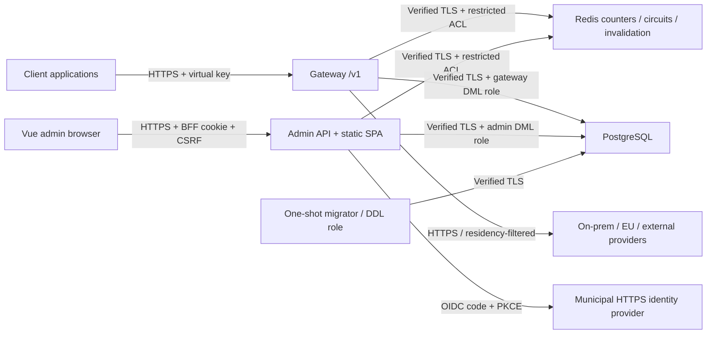

# Architecture

## Components and trust boundaries

The data plane has no admin endpoints; the control plane never proxies LLM traffic.
Production Vue files are served by Admin API, not a Vite server. No browser OIDC tokens
are saved. Local Aspire uses Keycloak and FakeLlm; production uses an operator-approved
HTTPS IdP and provider configuration. Model IDs, capabilities, parameter profiles,
prices and fallback targets are data-driven.

Compose: `data` is internal and has no DB/cache host ports. `edge` contains the two
HTTPS APIs on separate loopback-bound listeners by default. `llm` is a separate gateway
network for provider connectivity; it is not itself an egress firewall. Municipal
firewall/DNS controls must enforce actual allowed destinations, management access and
public exposure. Admin API shares Redis for audited circuit controls/invalidation;
isolating Redis to the gateway alone would break these control-plane functions.

## Request and accounting flow

Client address (from `X-Forwarded-For` only on connections from trusted proxies, held in the catalogue snapshot) ->
bounded JSON request -> HMAC authentication -> key address allow-list -> key attachment policy -> model/endpoint authorization -> Redis
rate limit (sliding minute, requests in progress) -> optional PII policy -> routing rules (optional, see routing-rules.md) ->
residency/capability/context-window route filter -> team and key request policy -> hierarchical budget reservation -> provider
invocation (fallback; the last candidate retried once) -> usage reconciliation -> metadata writer.
Fallback occurs for transient failures (408, 409, 429, 5xx, timeouts, connection errors, invalid JSON) and
provider-configuration failures (upstream 401/403/404, plain HTTP in production, an undecryptable credential, an
endpoint the provider type cannot serve), never after streaming has sent bytes. Only transient failures count
toward the circuit breaker, so a misconfigured provider does not open its circuit. A transient failure with `Retry-After`
puts that deployment on a shared cooldown instead (it goes last until then; read in the same Redis `MGET` as the circuits).
Within a priority, targets are ordered by weight, or with `Gateway:LoadBalancing=LeastLoaded` by power of two choices over
per-instance latency, success and in-flight averages (`DeploymentLoad`). Unknown JSON fields pass through;
model parameter rewrites are explicit.
Every request that passes authentication ends in exactly one usage record: an unexpected exception after acceptance
releases the budget reservation, is recorded (outcome `ProviderError`, error `internal_error`; an HTTP request is charged nothing, a live session what it
used so far) and answers 500 `internal_error` if nothing was sent yet; a client abort is recorded as 499. A shared store that times out during accounting is
logged and the usage record is still written. While the database refuses writes, batches go to the usage journal in Redis
(below), so the queue does not fill; without a journal, or when it is full, a record is dropped (and logged) if the usage
queue stays full for 10 s.
Anthropic/OpenAI translation covers the implemented text/image/document/tool/streaming paths; content the Messages API
cannot take (audio, other file types) is rejected with `unsupported_content` rather than dropped.

With warm caches the request path makes no Postgres calls and two Redis round trips before the first byte (rate limit
pipelined with circuit state; one atomic budget reservation), plus one pipelined round trip for reconciliation after the
response. Key and catalogue caches are refreshed in the background when they expire and dropped immediately on an admin
invalidation. Details and benchmarks: [performance.md](performance.md).

### Routing rules

Optional administrator-defined rules (see [routing-rules.md](routing-rules.md)) run after the PII policy and before candidate selection. A rule matches on the request
(model name, headers, selected body parameters, key/team/department, budget and token-limit use, PII found, prompt size) and rewrites where it goes: weighted targets,
ordered fallbacks and optional chaining. Rules are stored in Postgres (`RoutingRules`, `RoutingRuleTargets`), compiled once per catalogue snapshot (invalid rules are skipped
and logged), and invalidated like other configuration over the Redis bus (30 s cache as fallback). `IRouteResolver` turns a decision into an attempt list and applies every hard
constraint afterwards, so a rule can never widen a key's access. The matched rule id is returned in `x-ume-rule` and stored on the usage record; credentials and prompt content are never
visible to conditions. The admin API (`/api/routing-rules`) audits every change and offers validation and a dry run.

Budgets are calendar-aligned in Europe/Stockholm; persisted timestamps are UTC. Limits, spend counters and
reservations are in USD (micro-USD in Redis), the currency prices are in, so enforcement does not move with
exchange rates. Reservations atomically check every budget. Rotation shares predecessor budgets and
spend, including grace-period keys. Redis counters rebuild from persisted usage on a
cold start. Pricing uses effective-date USD rates, and every cost is recorded and reported in USD only (SEK was
removed in 0.8.1).

Usage records go from the request into a bounded in-memory queue; a background writer copies them to Postgres in batches,
off the request path. **Usage journal** (`Gateway:UsageJournal`, `UsageWriter`/`IUsageJournal`): when Postgres refuses a
batch (`Spill`, the default), the writer puts it in Redis (`ume:usage-journal*`) and keeps draining the queue there, so a
database outage neither drops records nor holds up requests; journaled batches are written when Postgres is back (a
separate loop, every 2 s), deduplicated by request id. A gateway instance that stops leaves its batches behind; after
`AbandonedAfterSeconds` (120) another instance takes them over. `Always` journals every batch before writing it, so a
crash loses nothing; `Spill` has no cost while Postgres is healthy, and a crash then loses at most the batch being written.
The journal is capped (`MaxRecords`, 1 000 000, about 1 GB in Redis); beyond it, and with `Off`, a refused batch is kept in
memory and retried as before. Redis runs without persistence here, so the journal outlives a gateway instance and a
database outage, not a Redis restart. Cold-start budget reconstruction can lag in-flight usage, and streaming estimates can
differ from provider billing; this POC must not be presented as exact invoicing.

**Token quotas.** A budget counts USD (default) or, with `Unit: Tokens`, input plus output tokens, optionally only of
providers of one residency (for on-prem capacity, whose models cost nothing). Both kinds are reserved in the same Redis
script (one amount per counter); a residency quota applies when one of the candidate providers has that residency, and is
charged the actual tokens only when the provider that served the request does (a fallback elsewhere refunds the
reservation). Counters are `ume:spend-tok:*`, seeded from usage records and monthly totals like the USD ones.

### Code layout

- **Gateway.** `GatewayEndpoints` (Domain) is the one table of endpoint semantics: routing name, client and upstream
  path, required capability, model kinds, and the audio, realtime and streaming flags. HTTP and realtime requests share
  the pipeline stages in `GatewayRequestHandler` (routing, candidates, budget reservation, credentials, accounting).
  `ProviderAuth`/`ProviderTransport` hold provider authentication and HTTP details, and `FailureKind` decides fallback
  and circuit breaking. `/v1/models` and realtime input transcription models use the same eligibility rule as routing.
  One folder (and namespace) per concern: `Requests` (the handler and its stages, errors, headers, request id),
  `Authentication` (virtual keys, failed-attempt throttling and recording, client addresses), `Routing` (catalogue, route
  resolution, deployment load, provider credentials), `Budgets` (reservation, alerts), `Usage` (usage writer, metrics),
  `Forms` (multipart uploads), `Realtime` (live audio) and `Operations` (the signed status endpoint for the admin API).
  `GatewayServices` registers every service and `GatewayRoutes` maps the client API.
- **Domain.** Entities in `Entities/`, one file each; the shared enums at the root, grouped by topic (`ProviderEnums`,
  `PolicyEnums`, `BudgetEnums`, `KeyEnums`, `UsageEnums`, `GatewayEndpoint`). Pure logic sits in one folder (and
  namespace) per concern: `Routing` (rule sets, expressions, route selection), `Budgets`, `Usage` (cost, audio duration,
  retention), `Keys` (hashing, rotation), `Pii`, `ContentGuard`, `Providers`, `Requests` (policy, rewriting),
  `Networking` and `Export` (CSV cells). Nothing in Domain touches a database or the network.
- **Infrastructure.** `Persistence` (the `GatewayDbContext`, migrations, shared queries), `Stores` (one file per store:
  its contract, the in-memory version for development and tests, and the Redis version), `Security` (key hashing,
  credential protection, client addresses, security events) and `Providers`: the shared adapter base, transport, SSE and
  usage parsing at the root, and one folder per wire protocol, `Anthropic` and `OpenAI` (the OpenAI-compatible adapter
  and the Responses bridge). A new provider protocol gets its own folder.
- **Data API.** `Authentication` (OAuth client credentials and Data API keys, read logging) and `Feeds` (the endpoints,
  their records and cursor paging); `DataApiServices` registers options, authentication and the per-client rate limit.
- **ServiceDefaults.** What every host shares: telemetry, health endpoints, shutdown drain, error responses, security
  headers, `AddValidatedOptions` (bind and validate on start) and `AddPerMinutePolicy` (fixed one-minute rate limits).
- **Shared.** `RedisKeys` (Infrastructure) lists every Redis key and channel; all live under `ume:`, which the restricted
  ACL in `deploy/redis/users.acl.example` relies on. `GatewayQueries` (Infrastructure) holds the key
  rotation lineage and budget spend queries used by both the gateway and the admin API.
- **Admin API.** One folder (and namespace) per feature: `Organisation`, `Keys`, `DataAccess`, `Catalog` (providers,
  models, routes; `Catalog/Pricing` for the models.dev and Azure list prices), `Budgets`, `RoutingRules`, `Reports`,
  `Operations` and `Settings`. A feature folder holds its `*Endpoints` (routes, roles, OpenAPI text only), its service
  (the logic) and its `*Contracts` (request and response records). Shared pieces sit in `Common` (`AdminContext`,
  `AdminRequest` validation, `OwnerScopeResolver`, `AdminOptions`), `Auditing` (action and entity names, audit snapshots)
  and `Security` (sign-in, roles and policies, sessions, CSRF, admin activity, rate limiting). `AdminServices` registers
  every service and `AdminEndpoints` maps every feature under `/api`.
- **ServiceDefaults.** `WebDefaults` (`ExitIfHealthProbeAsync`, `AddUmeWebDefaults`/`UseUmeWebDefaults`,
  `UseUmeSecurityHeaders`) and `ApiExceptionHandler` with `ApiFaultException` give the admin API and Data API the same
  JSON, problem responses, security headers and 500 message. API messages are in English.

## Stored and transient data

Postgres stores organization, key HMACs/prefixes, gateway-wide settings (trusted proxies, retention; one `GatewaySettings` row),
monthly usage totals kept after the nightly retention job removes old usage records (ADR 016), encrypted provider credentials,
certificate-protected Data Protection keys, routes/routing rules/prices/budgets, metadata-only usage,
alerts and masked append-only audit entries. Redis stores namespaced numerical counters,
circuit state and invalidation signals. Neither stores conversation content.
Bodies are processed transiently in memory and sent to authorized providers; provider
retention/training behavior is a separate contractual and technical responsibility.

HMAC pepper, Redis/database passwords, OIDC secret and certificates are mounted from
operator-managed per-service secret directories. Certificate/pepper continuity matters:
losing the pepper invalidates existing keys; losing the Data Protection certificate/key
ring makes existing provider credentials and BFF state unreadable.

## Operational surfaces

`/health/live`, `/health/ready`, `/version` are metadata-only. OTel metrics use bounded
labels for request outcomes, providers, endpoints, tokens, cost (`ume.gateway.cost.usd`), duration and queue depth. With `Gateway:GenAiMetrics=true` (off by default: four more histogram
recordings per request) also the OpenTelemetry GenAI semantic-convention metrics (`gen_ai.client.token.usage`,
`gen_ai.client.operation.duration`, `gen_ai.server.request.duration`, `gen_ai.server.time_to_first_token`, with the
catalogue's upstream model name), so standard GenAI dashboards work.
The authenticated ops API displays component status, schema/version, provider statistics,
drain/circuit actions and key-cache invalidation. Reachability is not a successful upstream
inference probe; an idle provider's historical latency is unavailable, not zero.

## Scope and confirmed decisions

Originally approved scope, kept here after the delivery plan was retired. It is a POC; the
[security and compliance](security-and-compliance.md) release gates still apply.

| Topic | Decision |
|---|---|
| Providers | Ollama (local and cloud), Azure OpenAI, Azure AI Foundry, OpenAI, Anthropic, generic OpenAI-compatible (vLLM etc.) |
| Hierarchy | Department (förvaltning) -> team -> virtual key, budgets at every level |
| Admin auth | Generic OIDC through a BFF; Keycloak in local run mode, an external HTTPS IdP in production |
| Content logging | Metadata only; prompts and responses are never persisted |
| PII guard | Optional, per key: Off / Allow / Redact / Block / Reroute to on-prem |
| Currency | Prices, costs and budgets in USD |
| Client API | OpenAI `/v1/chat/completions` (SSE), `/v1/embeddings`, `/v1/models`, `/v1/responses`, `/v1/audio/transcriptions` and `/v1/audio/translations` (multipart, held in memory), `/v1/images/generations` and `/v1/images/edits` (JSON; multipart held in memory), live audio over WebSocket on `/v1/realtime` and `/v1/realtime/translations` (OpenAI Realtime protocol, relayed and metered); Anthropic `/v1/messages` |
| Budget exceeded | Hard block at 100 %, alerts at configurable thresholds |
| Key rotation | Per rotation: immediate revoke (default) or 24 h grace |
| Rate limits | Per key (requests and tokens), Redis-backed, Redis secured by default |
| Provider classification | OnPrem / EU / External; drives PII rerouting and key residency limits |
| Admin UI | Vue 3 + Pinia + Tailwind CSS v4, English, light/dark/Lumen, accessibility target WCAG 2.2 AA (see the [statement](accessibility-statement.md)) |

Out of scope for the POC: semantic caching, an MCP gateway, SSO for gateway clients (keys only),
other currencies than USD, and invoicing integration (CSV export per cost centre instead).

See [ADRs](adr.md), [runbook](runbook.md) and the exact [API contract](admin-api.md).
